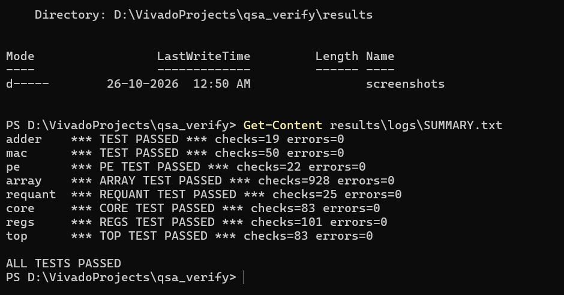
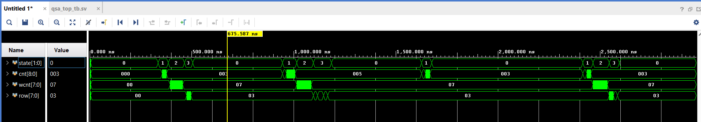
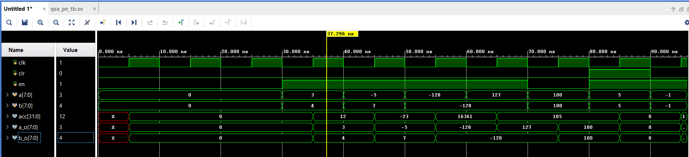

# QSA-Verify

Coverage-driven **UVM 1.2** verification of a quantized **INT8 systolic-array** inference accelerator.

> **Status: in progress.** The RTL is my own simplified educational design. Results tables contain measured numbers only; anything not yet measured says "pending".

## What this project is

AI accelerators fail in numerics (signed INT8 extremes, rounding, saturation) and in stream handling (backpressure, reset mid-operation), which protocol-only testbenches never examine. This project builds a small INT8 MAC array (AXI4-Lite control, AXI4-Stream data) and a UVM environment around it that checks both.

## Planned verification features

- Numerics-aware functional coverage (operand extremes, rounding ties, saturation, K boundaries)
- Dual-oracle checking: SystemVerilog reference model cross-checked against an independent NumPy model
- 20+ SVA assertions with cover properties
- Mutation testing: 16 injected RTL bugs, with the testbench kill rate measured
- A quantized digit classifier run bit-exactly through the RTL
- Vivado synthesis numbers (LUT / FF / DSP / Fmax)

## Progress

| Phase | Status |
|---|---|
| 0. Environment and warm-up (adder and MAC UVM testbenches on xsim) | Done |
| 1. Spec v1.0 and verification plan | Done |
| 2. RTL (PE, systolic array, requantization, control core, AXI4-Lite registers, top) | Done |
| 3. Python golden model and vectors | In progress (golden model done, vector generator pending) |
| 4. UVM environment (stage 1 of 5: stream agents, reference-model scoreboard, base test) | In progress |
| 5. Coverage closure | Pending |
| 6. Mutation testing | Pending |
| 7. Real-model demo | Pending |

## Results

| Metric | Measured |
|---|---|
| Functional coverage | pending |
| Scoreboard mismatches | pending |
| Mutation score | pending |
| Real-model logit mismatches | pending |

## Evidence

Directed tests: 8 of 8 pass. Each ends with a result line such as `*** TOP TEST PASSED *** checks=83 errors=0`.



End-to-end run (register programming, four jobs, interrupts):



One MAC processing element, checked against hand-computed accumulator values (12, -23, 16361, 105, 105, 0, 1):



- Logs for every test: `results/logs/`
- Deliberate-bug checks: [results/break_tests.md](results/break_tests.md)

## Documents

- [Specification v1.0](spec/qsa_spec_v1.0.md)
- [Verification plan v1.0](spec/qsa_vplan_v1.0.md)

## Repository layout

```
spec/     specification and verification plan
rtl/      DUT (written by the author)
tb/       UVM testbenches
python/   golden model, vector generator, regression and mutation scripts
vectors/  generated stimulus and expected outputs
results/  coverage reports, logs, plots
```

## Toolchain

AMD Vivado 2022.2 simulator (xvlog, xelab, xsim), UVM 1.2, Python 3, Git, on Windows 11.

## Reproduce the results

In the Vivado Tcl Shell, from the repo root:

```
cd D:/VivadoProjects/qsa_verify
source run_all.tcl
```

This compiles and runs every testbench and saves one log per test in `results/logs/`, plus `results/logs/SUMMARY.txt`. Each test ends with a line such as `*** TOP TEST PASSED *** checks=NN errors=0`.

Python golden model self-test (Windows PowerShell, repo root):

```
python python\test_qsa_model.py
```

## Author

Blessy Evangeline S, B.Tech ECE (VLSI, AI/ML hardware).

## License

MIT
